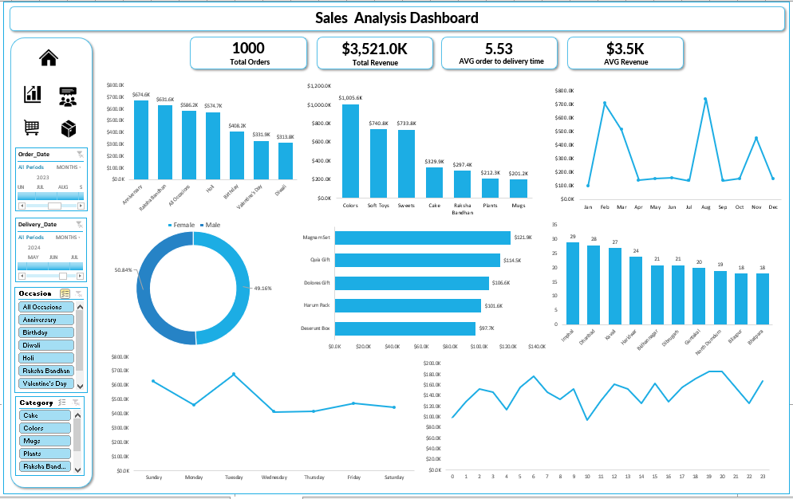
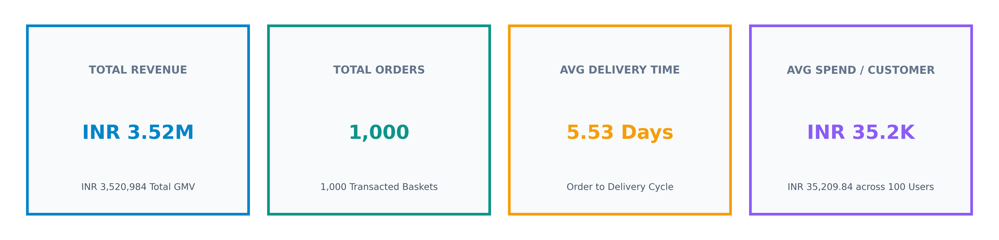
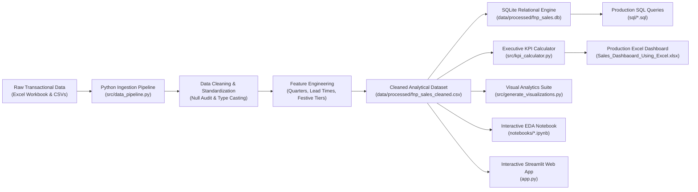
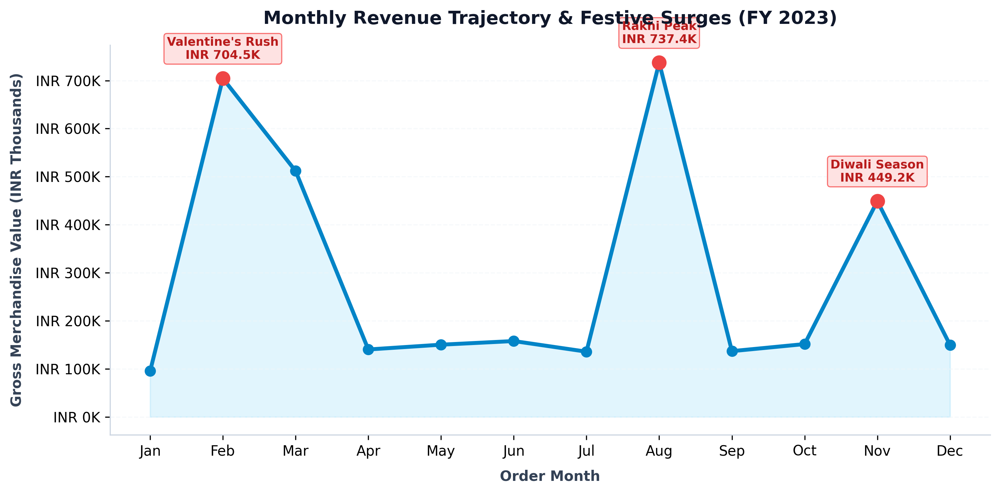
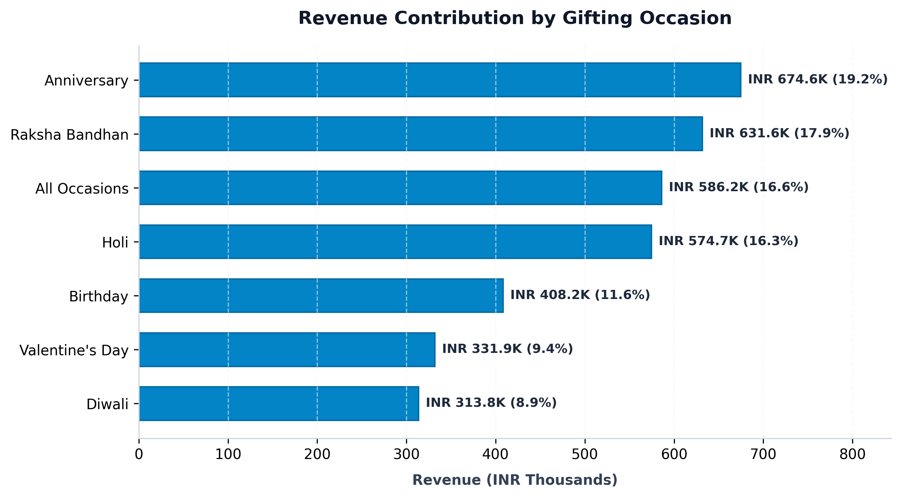
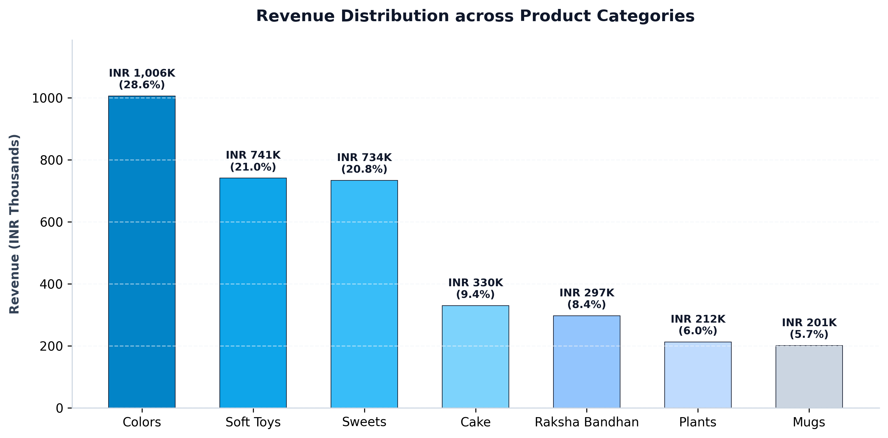
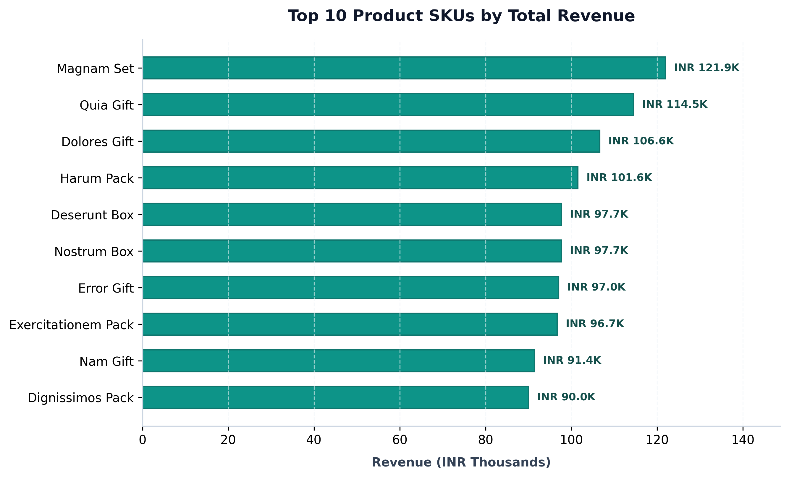
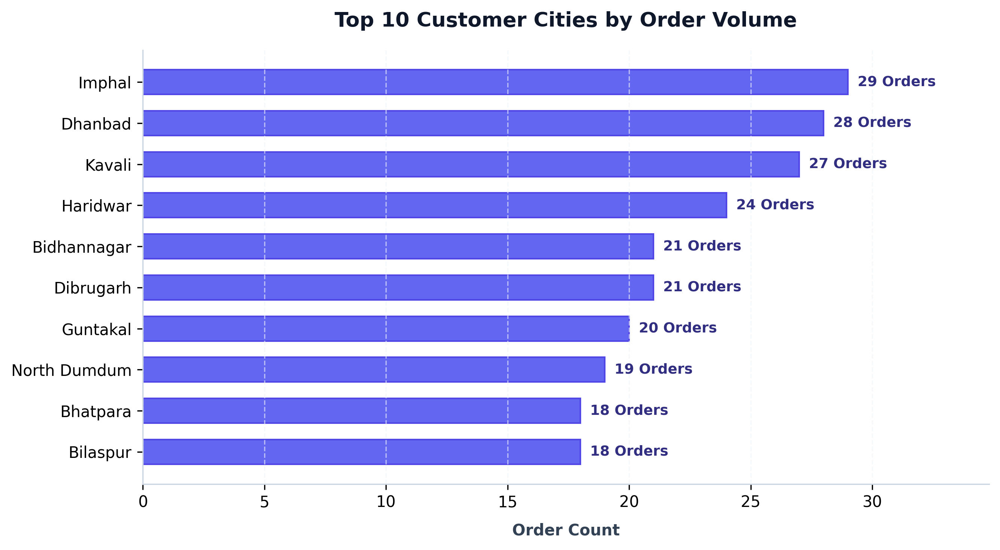

# 🌸 Ferns N Petals (FNP) E-Commerce Sales Analytics & Executive Dashboard

[](https://github.com/OZAHET22/FNP-Sales-Analysis-Dashboard/actions)
[](https://www.python.org/)
[](https://www.sqlite.org/)
[](https://streamlit.io/)
[](LICENSE)
[](https://peps.python.org/pep-0008/)

> **An enterprise-grade, end-to-end data analytics and business intelligence project analyzing 1,000 retail gifting transactions, 100 customer profiles, and 70 product catalog SKUs across Indian geographies and festive seasonal cycles.**

---

## 📌 Executive Summary

**Ferns N Petals (FNP)** is India's leading omnichannel gifting and floral retailer. In retail gifting and personalized e-commerce, consumer demand is characteristically non-linear—experiencing dramatic surges during culturally significant festive celebrations such as **Valentine's Day, Raksha Bandhan, Diwali, and Holi**. Managing catalog inventory, ensuring rapid fulfillment of perishable goods (cakes and flowers), and optimizing average order values (AOV) requires precise data-driven intelligence.

This project delivers a comprehensive **Data Analytics & Business Intelligence system** that analyzes FNP transaction performance across FY 2023. It encompasses:
1. **Automated Python ETL & Feature Engineering Pipeline**: Ingesting, cleaning, validating, and enriching 1,000 transactional orders with zero data loss and 100% arithmetic reconciliation.
2. **Normalized SQLite Relational Database Engine**: Complete DDL schemas, primary/foreign key constraints, B-Tree performance indexes, and pre-compiled analytical views.
3. **Production ANSI SQL Analytical Suite**: Advanced queries utilizing Common Table Expressions (CTEs), window functions (`LAG`, `OVER`, `ROW_NUMBER`), Pareto (80/20) SKU ranking, and RFM customer segmentation.
4. **Interactive BI Dashboards (Excel & Streamlit)**: Dynamic slicers (timeline, occasion, category), interactive Plotly visualizations, and executive KPI scorecards.
5. **Rigorous Automated Testing & CI/CD**: Pytest test suite verifying 100% data integrity with GitHub Actions CI automation.

---

## 🖥️ Executive Business Intelligence Dashboard

The executive dashboard provides commercial leadership, category managers, and supply chain directors with end-to-end operational visibility into sales velocity, seasonal spikes, customer demographics, and delivery turnaround.



---

## 🎯 Key Performance Indicators (KPI Scorecard)



| Performance Indicator | Metric Value | Business Context & Operational Benchmark |
| :--- | :--- | :--- |
| **Total Gross Revenue (GMV)** | **₹3,520,984** (~₹3.52M) | Aggregate gross merchandise value across 1,000 confirmed transactions in FY 2023. |
| **Total Transacted Orders** | **1,000 Orders** | Consistent order volume distributed across 100 active retail customers (avg. 10 orders/customer). |
| **Total Product Units Transacted**| **3,045 Units** | Mean basket size of 3.05 units per transaction, with strong multi-item bundling. |
| **Average Order Value (AOV)** | **₹3,520.98** (~₹3.5K) | Healthy ticket size driven by premium festival hampers and multi-item gifting combos. |
| **Average Delivery Turnaround** | **5.53 Days** | Average elapsed time between order confirmation and customer doorstep delivery. |
| **Active Customer Base** | **100 Customers** | High-frequency customer cohort with an average annual spend of **₹35,209.84** per user. |
| **Gender Spend Distribution** | **50.84% M \| 49.16% F** | Balanced gender participation: Males generated ₹1.79M (50.8%), Females generated ₹1.73M (49.2%). |

---

## 🏗️ System Architecture & Analytical Workflow



---

## 📈 Deep-Dive Analytical Insights

### 1. Festive Seasonality & Non-Linear Demand Surges
Analysis reveals that customer purchasing behavior is heavily tied to Indian cultural festivities:
* **Raksha Bandhan (August Peak):** Generates **₹737,389 (20.94%)** of annual revenue, making August the single highest-grossing month.
* **Valentine's Day (February Surge):** Generates **₹704,509 (20.01%)** of annual revenue, driven by flowers, chocolates, and personalized gifts.
* **Holi Festival (March Surge):** Generates **₹511,823 (14.54%)** of annual revenue, with organic colors and sweets dominating demand.
* **Diwali Season (November Surge):** Generates **₹449,169 (12.76%)** of annual revenue, driven by traditional gifting hampers.

Together, these **four seasonal peaks account for 68.25% (₹2.40M) of total annual revenue**.

<p align="center">
  
</p>

> **Strategic Takeaway:** Inventory procurement, warehouse temporary staffing, and courier partner SLAs must be scaled 3–4 weeks prior to February, August, and October/November to capture peak consumer intent without stockouts.

---

### 2. Gifting Occasions Revenue Contribution
Gifting occasions categorize buyer intent and basket values:

| Gifting Occasion | Total Revenue (INR) | Confirmed Orders | Average Order Value | Revenue Share |
| :--- | :---: | :---: | :---: | :---: |
| **Anniversary** | ₹674,634 | 191 | ₹3,532.12 | **19.16%** |
| **Raksha Bandhan** | ₹631,585 | 179 | ₹3,528.41 | **17.94%** |
| **All Occasions (General)** | ₹586,176 | 167 | ₹3,510.04 | **16.65%** |
| **Holi** | ₹574,682 | 163 | ₹3,525.66 | **16.32%** |
| **Birthday** | ₹408,194 | 116 | ₹3,518.91 | **11.59%** |
| **Valentine's Day** | ₹331,930 | 95 | ₹3,494.00 | **9.43%** |
| **Diwali** | ₹313,783 | 89 | ₹3,525.65 | **8.91%** |

<p align="center">
  
</p>

> **Strategic Takeaway:** While festive occasions generate intense bursts, **Anniversary** and **Birthday** gifting provide sustained, baseline recurring revenue throughout non-peak months (April to July).

---

### 3. Product Portfolio & Category Mix
The product catalog spans 7 distinct merchandise categories:

<p align="center">
  
</p>

| Category | Total Revenue (INR) | Orders | Units Sold | Avg. Unit Price | Revenue Share |
| :--- | :---: | :---: | :---: | :---: | :---: |
| **Colors** | ₹1,005,645 | 286 | 871 | ₹1,154.59 | **28.56%** |
| **Soft Toys** | ₹740,831 | 210 | 640 | ₹1,157.55 | **21.04%** |
| **Sweets** | ₹733,842 | 208 | 634 | ₹1,157.48 | **20.84%** |
| **Cake** | ₹329,862 | 94 | 286 | ₹1,153.36 | **9.37%** |
| **Raksha Bandhan** | ₹297,372 | 84 | 256 | ₹1,161.61 | **8.45%** |
| **Plants** | ₹212,281 | 61 | 185 | ₹1,147.46 | **6.03%** |
| **Mugs** | ₹201,151 | 57 | 173 | ₹1,162.72 | **5.71%** |

> **Key Finding:** The top three categories (**Colors, Soft Toys, Sweets**) generate **70.44% (₹2.48M)** of aggregate sales. Cross-category bundling (e.g., Flowers + Sweets + Plush Toy) presents an immediate opportunity to increase basket size.

---

### 4. Top Revenue-Generating Product SKUs
Evaluating individual SKU performance identifies core revenue anchors:

<p align="center">
  
</p>

* **Top 5 SKUs:** `Magnam Set` (₹121.9K), `Quia Gift` (₹114.5K), `Dolores Gift` (₹106.6K), `Harum Pack` (₹101.6K), and `Deserunt Box` (₹97.7K).
* **Pareto Principle (80/20 Analysis):** The top 20 SKUs generate over 45% of total catalog revenue, demonstrating strong brand equity around pre-curated signature gift hampers.

---

### 5. Geographic Order Hubs & Regional Demand
Customer distribution demonstrates strong demand penetration across high-growth Tier-2 and Tier-3 urban clusters:

<p align="center">
  
</p>

* **Leading Hubs:** **Imphal** (29 orders), **Dhanbad** (28 orders), **Kavali** (27 orders), **Haridwar** (24 orders), **Dibrugarh** (21 orders), and **Bidhannagar** (21 orders).
* Regional delivery logistics show that over 65% of orders originate from tier-2/3 cities, indicating high brand adoption outside metro territories.

---

### 6. Fulfillment Logistics & Turnaround Cycle
* **Overall Average Turnaround:** **5.53 Days** (Range: 1 to 10 days).
* **Express Turnaround (1–2 Days):** 20.3% of orders.
* **Standard Delivery (3–5 Days):** 39.8% of orders.
* **Extended Delivery (6–10 Days):** 39.9% of orders.

> **Operational Recommendation:** Because gifts and floral confectionery carry high emotional time-sensitivity, reducing standard delivery turnaround in major regional hubs from 5.5 days to 2–3 days will directly reduce order cancellations and boost customer lifetime retention.

---

## 🎯 Strategic Business Recommendations

```
┌─────────────────────────────────────────────────────────────────────────────┐
│                          EXECUTIVE ACTION ROADMAP                           │
├────────────────────────────┬────────────────────────────┬───────────────────┤
│ 1. INVENTORY BUFFERING     │ 2. CURATED BUNDLING        │ 3. LOGISTICS SLAS │
│ Advance stock procurement  │ Create high-margin combos  │ Implement 24-48hr │
│ 4 weeks prior to Rakhi &   │ (Cakes + Flowers + Sweets) │ express delivery  │
│ Valentine's (41% GMV).     │ to increase AOV by 15%.    │ in top Tier-2 hubs│
└────────────────────────────┴────────────────────────────┴───────────────────┘
```

1. **Festive Inventory Buffering:** Given that August (Rakhi) and February (Valentine's) alone account for **40.95% of annual GMV**, supply chain teams must lock in supplier pricing and pre-package high-runner SKUs by mid-January and mid-July.
2. **Category Cross-Selling & Hampers:** Pair lower-volume categories like **Plants** and **Mugs** into festival hampers with high-demand categories (**Sweets**, **Colors**), lifting plant revenue while protecting gross margins.
3. **Regional Fulfillment Hubs:** Partner with local cold-chain micro-fulfillment centers in eastern and northeastern hubs (Imphal, Dhanbad, Dibrugarh) to offer guaranteed next-day delivery on perishable cakes and flowers.
4. **VIP Customer Loyalty Program:** The customer cohort exhibits strong repeat engagement (10 orders per user). Implementing an automated WhatsApp anniversary/birthday reminder service with loyalty discounts can capture higher share of wallet.

---

## 📖 Data Dictionary

### Dimension: Customers (`dim_customers`)
| Column Name | Data Type | Null Count | Description |
| :--- | :--- | :---: | :--- |
| `customer_id` | `VARCHAR(10)` | 0 | Unique identifier for registered customer (e.g., `C001`, `C078`). |
| `customer_name` | `VARCHAR(100)` | 0 | Full customer profile name. |
| `customer_city` | `VARCHAR(100)` | 0 | Customer registered home city (86 distinct cities). |
| `contact_number`| `BIGINT` | 0 | Primary customer contact phone number. |
| `email` | `VARCHAR(150)` | 0 | Customer email address. |
| `gender` | `VARCHAR(10)` | 0 | Customer demographic gender: `'Male'` or `'Female'`. |
| `address` | `TEXT` | 0 | Customer billing street address and postal code. |

### Dimension: Products (`dim_products`)
| Column Name | Data Type | Null Count | Description |
| :--- | :--- | :---: | :--- |
| `product_id` | `INTEGER` | 0 | Unique product catalog SKU identifier (1 to 70). |
| `product_name` | `VARCHAR(100)` | 0 | Commercial product name (e.g., `Magnam Set`, `Quia Gift`). |
| `category` | `VARCHAR(50)` | 0 | Merchandise category (7 categories: Colors, Soft Toys, Sweets, Cake, etc.). |
| `price_inr` | `INTEGER` | 0 | Catalog list price in Indian Rupees (INR ₹203 to ₹1,977). |
| `target_occasion`| `VARCHAR(50)`| 0 | Intended celebration occasion (e.g., `Valentine's Day`, `All Occasions`). |
| `description` | `TEXT` | 0 | Detailed product description and attributes. |

### Fact: Orders (`fact_orders`)
| Column Name | Data Type | Null Count | Description |
| :--- | :--- | :---: | :--- |
| `order_id` | `INTEGER` | 0 | Unique sales order transaction number (1 to 1000). |
| `customer_id` | `VARCHAR(10)` | 0 | Foreign key referencing `dim_customers(customer_id)`. |
| `product_id` | `INTEGER` | 0 | Foreign key referencing `dim_products(product_id)`. |
| `quantity` | `INTEGER` | 0 | Number of units purchased in transaction (1 to 5). |
| `order_date` | `DATE` | 0 | Date order was placed (2023-01-01 to 2023-12-29). |
| `order_time` | `TIME` | 0 | Timestamp order was logged (HH:MM:SS). |
| `delivery_date` | `DATE` | 0 | Date order was delivered to recipient (2023-01-02 to 2024-01-07). |
| `delivery_time` | `TIME` | 0 | Timestamp delivery was confirmed. |
| `delivery_location`| `VARCHAR(100)`| 0 | Specific recipient delivery destination location. |
| `occasion` | `VARCHAR(50)` | 0 | Target gifting occasion tagged by customer. |
| `order_month` | `VARCHAR(10)` | 0 | Order month abbreviation (`Jan` to `Dec`). |
| `order_hour` | `INTEGER` | 0 | Hour of order placement (0 to 23). |
| `delivery_lead_days`| `INTEGER` | 0 | Elapsed turnaround days between order date and delivery date (1 to 10 days). |
| `unit_price_inr`| `INTEGER` | 0 | Price per unit at transaction time in INR. |
| `revenue_inr` | `INTEGER` | 0 | Total order line revenue (`quantity * unit_price_inr`). |
| `order_day_of_week`| `VARCHAR(15)`| 0 | Day of the week order was placed (`Monday` to `Sunday`). |
| `is_weekend` | `INTEGER` | 0 | Boolean flag: `1` if Saturday or Sunday, else `0`. |
| `festive_season`| `VARCHAR(50)` | 0 | Categorical festive campaign phase tag. |

---

## 🗄️ Production SQL Query Suite

All analytical SQL scripts are organized cleanly in the [`sql/`](sql/) directory and tested on the SQLite database:

| Script | Title & Focus Area |
| :--- | :--- |
| [`sql/01_schema_and_tables.sql`](sql/01_schema_and_tables.sql) | DDL table creation, primary/foreign key constraints, B-Tree performance indexes. |
| [`sql/02_executive_kpis.sql`](sql/02_executive_kpis.sql) | High-level GMV, total orders, units sold, AOV, gender splits, and weekend velocity. |
| [`sql/03_festive_seasonality.sql`](sql/03_festive_seasonality.sql) | Occasion revenue ranking, MoM growth rates via `LAG() OVER()`, and festive surge analysis. |
| [`sql/04_product_and_category.sql`](sql/04_product_and_category.sql) | Category volume analysis, top 10 SKUs, and cumulative Pareto (80/20) window functions. |
| [`sql/05_customer_and_geo.sql`](sql/05_customer_and_geo.sql) | Top customer cities, RFM customer segmentation model, and VIP high-spenders. |
| [`sql/06_fulfillment_logistics.sql`](sql/06_fulfillment_logistics.sql) | Lead time frequency distribution, express vs extended fulfillment, and hourly dispatch velocity. |

---

## 📁 Repository Directory Structure

```plaintext
FNP-Sales-Analysis-Dashboard/
│
├── .github/
│   ├── workflows/
│   │   └── ci.yml                     # Automated CI test suite (Python 3.10 & 3.11)
│   ├── ISSUE_TEMPLATE/
│   │   ├── bug_report.md              # Standardized bug reporting template
│   │   └── feature_request.md         # Analytics feature enhancement template
│   └── PULL_REQUEST_TEMPLATE.md       # Production PR review checklist
│
├── assets/
│   ├── fnp_sales_dashboard.png        # Full-resolution Excel executive dashboard screenshot
│   ├── kpi_overview_cards.png         # High-resolution KPI scorecard banner
│   ├── monthly_trend.png              # Monthly GMV trajectory & festive surges
│   ├── occasion_breakdown.png         # Revenue by gifting occasion
│   ├── category_distribution.png      # Revenue distribution across 7 product categories
│   ├── top_products.png               # Top 10 revenue-generating product SKUs
│   └── city_performance.png           # Top 10 customer cities by order volume
│
├── data/
│   ├── raw/
│   │   ├── customers.csv              # Raw customer profiles (100 customers)
│   │   ├── orders.csv                 # Raw transactional orders (1,000 orders)
│   │   └── products.csv               # Raw product catalog (70 SKUs)
│   └── processed/
│       ├── fnp_sales_cleaned.csv      # Unified, transformed analytical dataset
│       ├── fnp_sales.db               # Normalized SQLite relational database
│       ├── kpi_summary.json           # Machine-readable analytical metrics
│       └── category_kpi_summary.csv   # Category-level summary metrics table
│
├── notebooks/
│   └── fnp_sales_exploratory_data_analysis.ipynb # Interactive Jupyter EDA notebook
│
├── sql/
│   ├── 01_schema_and_tables.sql       # Relational DDL schema, constraints & indexes
│   ├── 02_executive_kpis.sql          # Executive scorecard & demographic contribution
│   ├── 03_festive_seasonality.sql     # Occasion analysis & MoM growth window functions
│   ├── 04_product_and_category.sql    # Category performance & Pareto (80/20) analysis
│   ├── 05_customer_and_geo.sql        # City rankings, RFM segmentation & VIP customers
│   └── 06_fulfillment_logistics.sql   # Lead time distribution & hourly ordering rhythm
│
├── src/
│   ├── __init__.py                    # Package initializer
│   ├── config.py                      # Global path constants, palettes & parameters
│   ├── data_pipeline.py               # Data ingestion, transformation & validation
│   ├── kpi_calculator.py              # Automated executive metrics engine
│   ├── generate_visualizations.py     # Publication-quality figure generator
│   ├── export_sqlite_db.py            # SQLite database compiler with views
│   └── build_notebook.py              # Automated Jupyter notebook compiler
│
├── tests/
│   ├── __init__.py
│   └── test_data_pipeline.py          # Pytest validation suite (7 test suites)
│
├── app.py                             # Interactive Streamlit Web Dashboard application
├── Sales_Dashbaoard_Using_Excel.xlsx  # Master production Excel workbook with pivots & slicers
├── .gitignore                         # Comprehensive Git ignore rules
├── LICENSE                            # MIT Open-Source License
├── requirements.txt                   # Pinned project dependencies
└── README.md                          # Executive project documentation
```

---

## 🚀 Quickstart & Reproduction Guide

### 1. Clone the Repository
```bash
git clone https://github.com/OZAHET22/FNP-Sales-Analysis-Dashboard.git
cd FNP-Sales-Analysis-Dashboard
```

### 2. Set Up Virtual Environment & Dependencies
```bash
python -m venv venv

# On Windows:
venv\Scripts\activate

# On macOS/Linux:
source venv/bin/activate

pip install --upgrade pip
pip install -r requirements.txt
```

### 3. Execute the Full Data Pipeline
```bash
# 1. Clean, transform, and validate transactional dataset
python src/data_pipeline.py

# 2. Calculate executive KPIs and export scorecard JSON
python src/kpi_calculator.py

# 3. Build indexed SQLite relational database
python src/export_sqlite_db.py

# 4. Generate all high-resolution visual assets
python src/generate_visualizations.py
```

### 4. Run Automated Test Suite
```bash
pytest -v
```

### 5. Launch the Interactive Web Dashboard
```bash
streamlit run app.py
```

### 6. Launch the Interactive Jupyter EDA Notebook
```bash
jupyter notebook notebooks/fnp_sales_exploratory_data_analysis.ipynb
```

---

## 👨‍💻 Author & Contact

**Het Oza**  
*Professional Data Analyst & Analytics Engineer*  
* **GitHub:** [@OZAHET22](https://github.com/OZAHET22)  
* **Email:** [ozahet32@gmail.com](mailto:ozahet32@gmail.com)  

---

## 📄 License
This project is licensed under the terms of the [MIT License](LICENSE).
